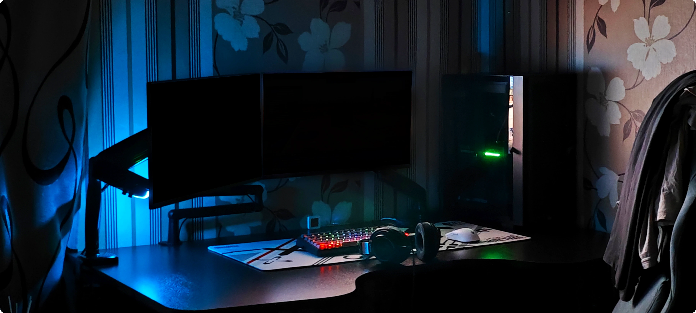
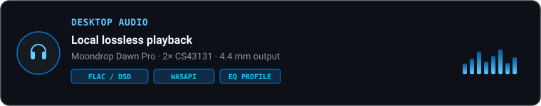

<a id="top"></a>

<div align="center">


<br><br>

<p align="center">
  <a href="https://github.com/Briclyaz?tab=followers"></a>
  <a href="https://github.com/Briclyaz?tab=repositories&type=source&sort=stargazers"></a>
  
  <a href="https://t.me/briclyaz"></a>
  <a href="mailto:prorok.new@mail.ru"></a>
</p>

<p align="center">
  <a href="https://github.com/Briclyaz/NLSound/releases">
    
  </a>
  <a href="https://github.com/Briclyaz/NLSound/stargazers">
    
  </a>
  <a href="https://github.com/Briclyaz/NLSound/releases">
    
  </a>
</p>

<p align="center">
  <a href="#about">About</a> ·
  <a href="#battlestation">PC Setup</a> ·
  <a href="#audio">Desktop Audio</a> ·
  <a href="#stack">Tools</a> ·
  <a href="#projects">Projects</a> ·
  <a href="#github-stats">GitHub Activity</a> ·
  <a href="#snake">Contributions</a> ·
  <a href="#contact">Contact</a>
</p>

</div>

---

<a id="about"></a>
## `01` — About

<sub>Python applications, Android audio configuration and small Windows utilities.</sub>

```powershell
PS C:\Users\Vitaliy> Get-Content .\profile.txt

Name        : Vitaliy Chichikaylo (@Briclyaz)
Main work   : Python web applications and internal tools
Open source : NLSound, a root audio module for Android
Also        : PowerShell automation and small Windows utilities
```

Most of my application work is tied to day-to-day tasks in educational organizations: student records, timetables, meal planning and inventory. Separately, I maintain NLSound and write small Windows utilities for my own workflow.

| Area | What I work on |
| :--- | :--- |
| **Web applications** | Python back ends and interfaces for records, schedules and internal calculations. |
| **Android audio** | Installer scripts, configuration patches and device-specific mixer presets for rooted devices. |
| **Windows utilities** | Tools that start daily applications, show schedule-based reminders and automate recurring tasks. |
| **Hardware and audio** | CPU/GPU undervolting, memory settings and a parametric EQ profile for my own setup. |

---

<a id="battlestation"></a>
## `02` — PC and peripherals

<sub>The hardware and settings currently in use on my main machine.</sub>

<div align="center">
  
  <p><em>My current desk setup.</em></p>
</div>

```ini
[workstation]
os     = Windows 11
cpu    = AMD Ryzen 7 9800X3D
gpu    = Palit GeForce RTX 5060 Dual OC
memory = 32 GB DDR5-6200 CL30
```

<details open>
<summary><b>PC (current settings)</b></summary>
<br>

| Part | Model / settings | Product link |
| :--- | :--- | :---: |
| **CPU** | **AMD Ryzen 7 9800X3D** `(PBO boost override +200 MHz, Curve Optimizer -30, FCLK 2133 MHz)` | [Amazon](https://www.amazon.com/s?k=AMD+Ryzen+7+9800X3D) |
| **Motherboard** | **MSI MAG B650 Tomahawk Max WiFi** | [Amazon](https://www.amazon.com/s?k=MSI+MAG+B650+Tomahawk+WiFi) |
| **RAM** | **32 GB (2×16 GB) Team T-Create DDR5** `(6200 MT/s, CL30, UCLK=MCLK, Hynix A-die)` | [Amazon](https://www.amazon.com/s?k=Teamgroup+T-Create+Expert+DDR5+32GB) |
| **GPU** | **Palit GeForce RTX 5060 Dual OC** `(0.825 V at 2600 MHz, memory offset +3000 MHz)` | [Gallery](https://www.google.com/search?tbm=isch&q=Palit+GeForce+RTX+Dual+OC) |
| **SSD #1** | **Netac NV5000 1 TB M.2 PCIe Gen4** | [Amazon](https://www.amazon.com/s?k=Netac+NV5000+1TB) |
| **SSD #2** | **Samsung 980 500 GB M.2 NVMe** | [Amazon](https://www.amazon.com/s?k=Samsung+980+500GB) |
| **Storage HDD** | **4 TB (2×2 TB) Toshiba DT01ACA200** `(two separate drives, no RAID)` | [Amazon](https://www.amazon.com/s?k=Toshiba+DT01ACA200+2TB) |
| **Chassis** | **Montech AIR 1000 Premium** `(mesh front panel)` | [Amazon](https://www.amazon.com/s?k=Montech+AIR+1000+Premium) |
| **Cooling Fans** | **Arctic P14 Pro PST (3×140 mm) + Arctic P12 Pro PST (1×120 mm)** | [Amazon](https://www.amazon.com/s?k=Arctic+P14+PWM+PST) |
| **Power Supply** | **1stPlayer GOLD PS-750SP 750 W** `(80 PLUS Gold)` | [Gallery](https://www.google.com/search?tbm=isch&q=1stPlayer+GOLD+PS-750SP) |

</details>

<details open>
<summary><b>Peripherals</b></summary>
<br>

| Category | Model / settings | Product link |
| :--- | :--- | :---: |
| **Monitors** | **2× Xiaomi Gaming G24i 2026** `(dual monitor arm)` | [Gallery](https://www.google.com/search?tbm=isch&q=Xiaomi+Gaming+Monitor+G24i) |
| **DAC / amp** | **Moondrop Dawn Pro** `(2× CS43131, 4.4 mm output)` | [Amazon](https://www.amazon.com/s?k=Moondrop+Dawn+Pro) |
| **Headphones** | **Philips SHP9500** `(4.4 mm cable, parametric EQ profile)` | [Amazon](https://www.amazon.com/s?k=Philips+SHP9500) |
| **Microphone** | **FIFINE AM8** `(software EQ and noise processing)` | [Amazon](https://www.amazon.com/s?k=FIFINE+AM8) |
| **Keyboard** | **AJAZZ AK820 MAX Ultra HE** `(magnetic switches, Rapid Trigger enabled)` | [Amazon](https://www.amazon.com/s?k=AJAZZ+AK820+MAX) |
| **Mouse** | **Ninjutso Sora V2** `(wireless, 800 DPI)` | [Gallery](https://www.google.com/search?tbm=isch&q=Ninjutso+Sora+V2) |
| **Mousepad** | **ProDevices 3.0 CORCUDA** `(Cordura surface)` | [Gallery](https://www.google.com/search?tbm=isch&q=ProDevices+CORCUDA+mousepad) |

</details>

---

<a id="audio"></a>
## `03` — Desktop audio

<sub>Current DAC, headphones and playback path on Windows.</sub>

<div align="center">
  
</div>

```yaml
desktop_audio:
  source: "Local FLAC and DSD files"
  windows_output: "WASAPI exclusive mode"
  dac: "Moondrop Dawn Pro (2× CS43131, up to 32-bit/384 kHz)"
  connection: "4.4 mm balanced output"
  headphones: "Philips SHP9500"
  processing: "Parametric EQ profile"
```

> [!NOTE]
> NLSound is a separate Android project and is not part of this desktop playback chain.

---

<a id="stack"></a>
## `04` — Tools I use

<sub>Grouped by the kind of work where I actually use them.</sub>

| Area | Tools |
| :--- | :--- |
| **Most application work** | `Python` `Django` `FastAPI` `SQLite` `PowerShell` `Git` |
| **Front end** | `HTML` `CSS` `JavaScript` `TypeScript` `Tailwind CSS` `Bootstrap` |
| **Android modules and scripts** | `POSIX shell` `Android Studio` `adb` `tinymix` |
| **Used in individual projects** | `C#` `C` `C++` `Flask` `Node.js` |
| **Development workflow** | `GitHub Actions` `Docker` `Postman` `VS Code` `Windows 11` |

---

<a id="projects"></a>
## `05` — Projects

<sub>Public Android work and a concise list of non-public application projects.</sub>

### [NLSound](https://github.com/Briclyaz/NLSound)

[NLSound](https://github.com/Briclyaz/NLSound) is my main public project and has been available on GitHub since 2021. It is installed as a root module with Magisk, KernelSU or APatch. I maintain the POSIX shell installer, XML patching and device presets.

```text
Package : root module
Runs on : Magisk / KernelSU / APatch
Changes : Android system properties / audio-policy XML / ALSA mixer controls
Code    : POSIX shell / XML / tinymix
```

> [!NOTE]
> NLSound does not implement a replacement Audio HAL or kernel driver. It applies configuration and mixer changes on rooted Android devices.

### Other projects

> **Source availability:** the code for the projects below is not public, so the descriptions are limited to their actual functionality.

| Project | What it does | Main tools |
| :--- | :--- | :--- |
| **Sovenok** | Stores student records, works with timetables and covers recurring administrative tasks in an educational organization. | `Python` `Django` `FastAPI` `SQLite` |
| **Student Nutrition Manager** | Calculates food requirements from menus and portion counts and keeps inventory records. | `Python` `SQL` |
| **StartSchool / Schedule** | Starts a configured set of Windows programs and shows reminders based on the current timetable. | `Python` `PowerShell` |

---

<a id="github-stats"></a>
## `06` — GitHub activity

<sub>Statistics generated from public repository data.</sub>

<div align="center">

<table border="0">
  <tr>
    <td align="center">
      
    </td>
    <td align="center">
      
    </td>
  </tr>
</table>

<br />


</div>

<sub>The language card groups public repositories by their primary language; it is not a proficiency score.</sub>

---

<a id="snake"></a>
## `07` — Contributions

<sub>Generated daily from my public GitHub contribution graph.</sub>

<div align="center">
  <picture>
    <source media="(prefers-color-scheme: dark)" srcset="https://raw.githubusercontent.com/Briclyaz/Briclyaz/output/github-contribution-grid-snake-dark.svg">
    <source media="(prefers-color-scheme: light)" srcset="https://raw.githubusercontent.com/Briclyaz/Briclyaz/output/github-contribution-grid-snake.svg">
    
  </picture>
</div>

---

<a id="contact"></a>
## `08` — Contact

<sub>Telegram and email are the quickest ways to reach me.</sub>

For NLSound bugs, device compatibility reports and reproducible technical questions, use the [project issue tracker](https://github.com/Briclyaz/NLSound/issues). For everything else, Telegram or email works best.

<div align="center">

<p align="center">
  <a href="https://t.me/briclyaz">
    
  </a>
  <a href="mailto:prorok.new@mail.ru">
    </a>
  <a href="https://github.com/Briclyaz">
    
  </a>
</p>

<p align="right"><a href="#top">▲ back to top</a></p>

</div>
